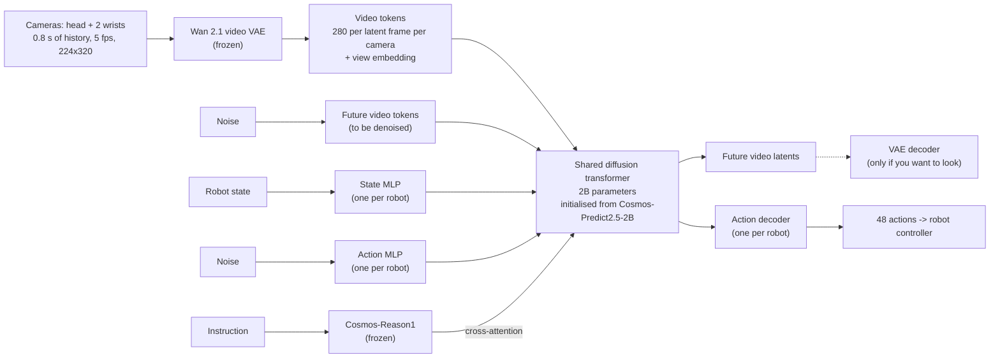

# GR00T 2: a hands-on walkthrough

GR00T 2 is NVIDIA's robot foundation model announced at CoRL on 2026-11-09. This guide
explains how it works, then lets you train, speed up and fine-tune a small model built the
same way, next to two real models you can run today.

> **What you can and cannot run (checked 2026-11-14).** GR00T 2 itself is not
> downloadable yet. NVIDIA has published a [white paper](https://research.nvidia.com/labs/gear/gr00t-2/assets/gr00t2_whitepaper.pdf)
> and a [project page](https://research.nvidia.com/labs/gear/gr00t-2/) that says "Code
> Available in December". There is no GR00T 2 repository on Hugging Face, and
> `NVIDIA/Isaac-GR00T` on GitHub still ships GR00T N1.7. So this guide runs three stand-ins:
>
> | What | Real weights? | Same design as GR00T 2? | Use it to learn |
> |---|---|---|---|
> | **Mini world-action model** (`scripts/wam.py`) | No, you train it in 13 minutes | Yes, at toy scale | the architecture, the inference tricks, LoRA adaptation |
> | **Cosmos3-Edge-Policy-DROID** (`make policy`) | Yes | Same idea (video and actions denoised together), different network | what a real world-action model costs to run |
> | **GR00T N1.7** (`scripts/gr00t_n17.py`) | Yes | No: it is the previous generation and the white paper's baseline | the GR00T tooling, and what GR00T 2 changed |
>
> Everything stated about GR00T 2 below comes from the white paper. Every number about the
> stand-ins was measured on this machine (RTX 5090, shared with another job).

## 1. The idea in one paragraph

Until now most robot foundation models, GR00T N1.7 included, were **vision-language-action
models (VLAs)**: a vision-language model looks at the cameras and the instruction, and a
small head turns its features into motor commands. The model is never asked what will
happen next. GR00T 2 is a **world-action model (WAM)**: it starts from a video generator and
is trained to produce two things at once, the next second and a half of video from every
camera and the actions that go with it. Predicting video is a task you can train on any
footage, including people doing chores with no robot in sight, which is why GR00T 2 could
learn from 400,000 hours of human video against 23,500 hours of robot teleoperation.

| | GR00T N1.7 (VLA) | GR00T 2 (WAM) |
|---|---|---|
| Starts from | Cosmos-Reason2-2B, a vision-language model | Cosmos-Predict2.5-2B, a video diffusion model |
| Output | a chunk of actions | a chunk of actions **and** the future frames of every camera |
| Training signal | actions only | video on all data, actions where they exist |
| Human video in pretraining | 20,000 hours | 402,730 hours |
| Action chunk | 40 steps | 48 steps (1.6 s at 30 Hz); 80 for the G1 humanoid |
| Open weights and code | Yes (Apache 2.0 code, NVIDIA Open Model License weights) | Not yet |

## 2. Architecture

One 2-billion-parameter transformer reads a single sequence of tokens. Three kinds of
input become tokens in that sequence, and two kinds of output are read back from it.



**Video.** A frozen VAE compresses each camera stream 4x in time and 8x in each spatial
direction. A 224x320 frame becomes a 28x40 latent, cut into 2x2 patches: 14 x 20 = 280
tokens per latent frame per camera. A learned embedding marks which camera a token belongs
to. Past frames enter clean, as context. Future frames start as noise.

**Language.** A frozen vision-language model encodes the instruction once. The transformer
reads it through cross-attention, so the instruction costs nothing extra per denoising step.

**State and actions.** These are the only robot-specific weights. Small MLPs lift the
robot's joint readings and the noisy action chunk to the transformer's width, and a decoder
maps the output back to that robot's action space. Each robot gets its own row of weights
in these MLPs, and every robot shares the transformer. A gripper arm, a 22-joint hand and a
humanoid differ only in a few small matrices.

**Who attends to whom.** Video tokens attend to each other across time and cameras. Action
tokens attend to all video tokens, including the future frames being generated. The paper's
phrase for the consequence: actions "follow the future the model imagines".

**Training objective.** Flow matching, with one loss for video and one for actions. Take the
true future `x`, mix it with noise `e` at a random level `t` to get `(1-t)x + t*e`, and train
the network to output `e - x`. The action loss is switched off for clips that have no
action labels, so those clips still train the video half.

### Inference: the 2v4a schedule

Generation runs the transformer a few times, each pass removing some noise. Video is most
of the tokens and most of the cost, but the robot only needs the actions. So GR00T 2 denoises
them on different schedules, written `2v4a`: two video steps, four action steps.

```
pass          1            2            3            4
video      denoise    (reuse pass 1)  denoise    (reuse pass 3)
actions    denoise      denoise       denoise      denoise
cost        full        tiny           full         tiny
```

On passes 2 and 4 only the action tokens run. They still attend to the video, by reusing the
attention keys and values the video tokens produced on the previous pass. This is the same
key-value caching that makes chat models fast, applied across denoising steps instead of
across words. Dexter (two arms with dexterous hands) runs `2v2a`, the YAM arms `2v4a`, and
the humanoid drops to `1v2a` to fit a Jetson.

### GR00T 2 Turbo

Most tokens are future video, and video is redundant. Turbo keeps the same 2B transformer
but swaps in a VAE that compresses 16x per side instead of 8x: a latent grid four times
smaller. It gives up some dexterity for speed, and it is the variant that runs on a
humanoid's onboard Jetson Thor (124 ms per plan).

## 3. How it is trained and adapted

**Pretraining, in three stages.** (1) Single-camera video prediction, mostly on human
egocentric video, to learn how hands and objects move. (2) Multi-camera video and actions
together, on human and robot data; human clips supply tracked hand poses as their
"actions". (3) The same again with robot data weighted up, since the result has to drive a
robot.

**Few-shot adaptation with LoRA.** To teach a new task, the paper freezes everything and
trains rank-32 LoRA adapters on every linear layer of the transformer, using the same
video-plus-action loss. Each episode is cut into 100 windows, sampled in proportion to the
frozen model's loss so training concentrates on the hard moments such as a grasp. One run
takes about 30 minutes on a single RTX 5090. The adapters are then merged into the weights.
Reported result on 50 tasks the target robot had never done: 40% success with no
demonstration, 71% with one, 95% with five.

**Reinforcement learning after that.** Noise is injected into the action denoising only
(video denoising stays deterministic) so the policy explores, and successful attempts are
reinforced. On three contact-heavy tasks success rose from 40-76% to 88-96%.

**An agent on top.** A reasoning model plans the steps, checks progress and can mark grasp
and release points on the image for GR00T 2 to follow. Three long toy-assembly tasks went
from 71-84% to 97-98% over 100 trials each.

## 4. Getting it to run in real time

A world-action model does more work per plan than a VLA. The paper's latency ladder for
Turbo on the humanoid shows where the time goes (median milliseconds per plan):

| Step added | RTX 5090 | Jetson Thor |
|---|---|---|
| Plain PyTorch, BF16 | 225 | 720 |
| Runtime clean-up: cache text features, reuse keys/values, precompute timestep terms | 184 | 615 |
| TensorRT engines | 95 | 256 |
| CUDA graph replay | 90 | 254 |
| FP8 on selected layers | 55 | 182 |
| Fewer denoising steps (2v4a to 1v2a) | **38** | **124** |

Full-size GR00T 2 on an RTX 5090 goes from 449 ms to 153 ms (Dexter) and from 551 ms to
180 ms (YAM).

Two more ideas keep motion smooth while the next plan is being computed:

- **Action chunking.** One plan covers 48 actions, 1.6 s. In several of the paper's setups
  the robot executes the first 30 while the next plan is computed.
- **Real-time chunking (RTC).** Each new plan is conditioned on the actions already
  committed, so consecutive chunks join without a jerk. The paper found that training with a
  slightly noised prefix worked better than a clean one.

For the humanoid the stack has three rates: a reasoning model picks the subtask, Turbo
plans 1.6 s of whole-body motion about once a second, and the SONIC controller tracks it at
50 Hz with joint control at 1 kHz.

## 5. Hands-on: a GR00T 2 you can train in 13 minutes

`scripts/wam_model.py` is a 7-million-parameter model with the structure from section 2,
and `scripts/wam_toy.py` is a small world for it to live in. `scripts/wam.py` drives both.

**The world.** A table with a red, a green and a blue block, seen by a fixed top camera and
a "wrist" camera that follows the gripper. Two robots: `point`, a free-floating gripper with
2-D position actions, and `arm`, a 3-link arm with 3-D joint actions. Three skills, given as
a sentence: *reach* a block, stop *below* it, stop *left* of it.

**What the model is shown.** 4,000 scripted demonstrations of only three robot-skill pairs:

| | reach | below | left |
|---|---|---|---|
| point | trained | trained | never |
| arm | trained | **never** | never |

So `arm/below` tests whether a skill shown to one robot transfers to another, and `left`
is a skill nobody was shown.

**How the miniature maps to the real thing.**

| | GR00T 2 | `wam_model.py` |
|---|---|---|
| Transformer | 2B parameters, from Cosmos-Predict2.5 | 6.5M parameters, from scratch |
| Video tokens | Wan 2.1 VAE latents, 280 per frame per camera | raw 4x4 pixel patches, 64 per frame per camera |
| Cameras, history, future | up to 4 cameras, 0.8 s of history | 2 cameras, 2 past frames, 4 future frames |
| Text encoder | Cosmos-Reason1, frozen | a frozen lookup table, 18 words |
| Per-robot parts | state MLP, action MLP, action decoder | the same three, 0.2M parameters per robot |
| Action chunk | 48 actions | 16 actions |
| Objective | flow matching on video and actions | the same |
| Inference | 2v4a with key/value reuse | the same |
| Adaptation | rank-32 LoRA on the transformer's linear layers | the same |

The miniature has no VAE, no pretraining and no real-time chunking. Its numbers say
something about the mechanisms, and nothing about how well GR00T 2 itself performs.

### Example 1: look at the token budget

```bash
make wam-describe
```

A plan processes 256 context video tokens, 512 future video tokens, 1 state token and 16
action tokens. The robot wants the 16; the 512 are what it costs to imagine the outcome.
The same ratio is why GR00T 2 Turbo exists.

### Example 2: train it, then run it closed loop

```bash
make wam-train     # 8,000 steps, about 13 min, 7.9 GiB of VRAM
make wam-eval
```

`eval` plans a 16-action chunk, executes the first 8, looks again and repeats for 48 steps.
Success means the gripper ends within 0.06 of the goal. Measured, 256 episodes per cell:

| | reach | below | left |
|---|---|---|---|
| point | 100% | 100% | 0% (never trained) |
| arm | 97% | **86% (never trained)** | 0% (never trained) |

The arm stops below a block 86% of the time without ever having been shown how. It learned
"below" from the other robot, because the skill lives in the shared transformer and only
the small action decoder is the arm's own. That is the mechanism behind GR00T 2's reported
zero-shot transfer from gripper arms and human video to a dexterous hand. `left` stays at
0%: nothing transfers from nowhere.

### Example 3: watch it imagine

```bash
make wam-imagine   # writes outputs/miniwam/base_imagine_2v4a.png
```

For each example the picture shows the frames the model predicted above the frames the
simulator produced after executing the predicted actions with no re-planning. In my run the
blocks stay put and the wrist view shows the target block arriving under the gripper, but
the moving gripper is faint in the top view and the wrist view carries patch-shaped noise.
More denoising steps did not sharpen it (mean pixel error 0.048 at 2v4a, 0.047 at 8v8a), so
the limit is the tiny model and short training, not the sampler. Task success is 97-100%
regardless: the imagined video does not have to be pretty for the actions that read it to
be right.

### Example 4: make it faster

```bash
make wam-bench                                    # one plan at a time
python scripts/wam.py bench --batch 64 --compile  # 64 plans per call
```

Median milliseconds per call over 50 calls on a quiet GPU, and success over the three
trained tasks. A single plan from a model this small is mostly Python and kernel-launch
overhead, so the batch of 64 is the better picture of where the arithmetic goes.

| Schedule | Key/value reuse | 1 plan: fp32 | bf16 | bf16 + `torch.compile` | 64 plans: fp32 | bf16 | bf16 + `torch.compile` | Success |
|---|---|---|---|---|---|---|---|---|
| 4v4a (every pass does everything) | n/a | 11.0 | 9.0 | 6.3 | 123 | 44.7 | 36.8 | 99.2% |
| 2v4a | no | 10.5 | 8.9 | 6.0 | 124 | 44.3 | 37.2 | 99.2% |
| 2v4a | yes | 7.5 | 7.0 | 4.8 | 64 | 25.4 | 21.1 | 99.2% |
| 2v2a | yes | 5.6 | 5.0 | 2.9 | 58 | 22.3 | 18.7 | 99.2% |
| 1v2a | yes | 3.7 | 3.8 | 2.4 | 32 | 13.0 | 10.8 | 99.2% |
| 1v1a | yes | 3.0 | 2.6 | 1.5 | 29 | 11.3 | 9.6 | 99.5% |

What this shows:

- **Reusing keys and values is where 2v4a gets its speed.** Without it, 2v4a costs the same
  as 4v4a, because the video tokens are recomputed on every pass. With it, the two
  action-only passes are nearly free: 2v4a costs about as much as 2v2a.
- **Step count is the biggest lever, and here it is free.** 1v2a is 3.4x cheaper than 4v4a
  with no loss of success. This task is easy and has one right answer. The paper tunes
  steps per robot and checks on the physical robot each time, because on hard tasks fewer
  steps cost success and smoothness.
- **Precision matters once the work is arithmetic.** bf16 does nothing for a single plan
  and gives 2.5x to 2.8x on the batch of 64. The same split explains the paper's ladder: TensorRT
  and CUDA graphs remove overhead, FP8 removes arithmetic.
- **`torch.compile` helps most where overhead dominates**: 1.4x to 1.7x on a single plan,
  1.2x on the batch.
- Stacked, 4v4a in fp32 to 1v2a in compiled bf16 is 11.4x on the batch (123 ms to 10.8 ms).

Try `python scripts/wam.py eval --execute 16` (never re-plan inside a chunk): `arm/below`
falls from 86% to 77%. Re-planning often is what makes a mediocre plan good enough, and it
is only possible if planning is fast.

### Example 5: teach it a new skill from five demonstrations

```bash
make wam-adapt                  # arm/left, 5 demonstrations
make wam-adapt SHOTS=1
python scripts/wam.py adapt --task arm/below --shots 5
python scripts/wam.py adapt --shots 5 --full      # fine-tune everything instead
```

This is the paper's recipe: freeze the model, add rank-32 LoRA adapters to every linear
layer in the transformer (1.1M trainable parameters), train on the same video-plus-action
loss, merge. 400 steps take about a minute.

| Task | Demonstrations | Before | After |
|---|---|---|---|
| arm/left (new skill) | 1 | 0% | 13% |
| arm/left | 5 | 0% | 55%, 91%, 54% (three different sets of five) |
| arm/left | 20 | 0% | 88% |
| arm/below (already 86% zero-shot) | 5 | 86% | 90% |
| arm/left, full fine-tune instead of LoRA | 5 | 0% | 27% |

What this shows:

- **A handful of demonstrations is enough for a skill the model has the parts for.** It
  already knew how to move the arm and find a coloured block; five episodes taught it the
  offset.
- **Which five matters.** The same recipe gave 54% and 91% with different demonstrations.
  One run of a few-shot experiment tells you little.
- **LoRA beat full fine-tuning at the same settings** (55% against 27%), and full fine-tuning
  on `arm/below` made it worse (86% to 34%). With 240 training windows, fewer trainable
  parameters is a feature.
- **The adapter is a specialist.** After learning `arm/left`, success on the three original
  tasks fell from 99% to between 7% and 37%. The paper trains one adapter per task and
  does not report what happens to the others. If you need one model that keeps old skills,
  mix old data into the fine-tune.
- **Settings matter more than the idea.** My first attempt (learning rate 1e-3) drove
  `arm/below` from 86% down to 38%. 1e-4 is the default now.
- Sampling training windows by the frozen model's loss, as the paper does, made no
  measurable difference here (45% against 48% with uniform sampling, one run each).

### Example 6: is imagining the future worth it?

```bash
python scripts/wam.py train --no-video --name vla                      # same network, actions only
python scripts/wam.py train --action-frac 0.1 --name wam_10pct         # 10% of episodes keep action labels
python scripts/wam.py train --no-video --action-frac 0.1 --name vla_10pct
python scripts/wam.py eval --name vla
```

`--no-video` removes the future frames and the video loss. What is left is the layout of a
VLA: look at the current frames, output actions. `--action-frac` strips the action labels
from most episodes, the way human video has none; the world-action model can still train
its video half on them. Same 8,000 steps for every run, one seed each.

| Model | Action labels | point reach | point below | arm reach | arm below (never trained) |
|---|---|---|---|---|---|
| World-action | all 4,000 episodes | 100% | 100% | 97% | **86%** |
| Action-only | all 4,000 | 100% | 100% | 99% | 66% |
| World-action | 400 (10%) | 49% | 46% | 23% | 16% |
| Action-only | 400 (10%) | 91% | 93% | 49% | 19% |
| World-action | 80 (2%) | 11% | 7% | 9% | 6% |
| Action-only | 80 (2%) | 6% | 5% | 12% | 4% |

Two results, pulling in opposite directions:

- **With plenty of labels, predicting video helped transfer.** Both models master what they
  were trained on, but the world-action model carries the "below" skill to the other robot
  better (86% against 66%).
- **With few labels, predicting video hurt.** At 10% labels the action-only model is far
  ahead. The extra unlabelled video did not rescue the world-action model. It made things
  worse.

The second result is not what the GR00T 2 paper reports at scale, where more human video
raised real-robot task progress from 50% to 70%. The setups differ in ways that plausibly
matter: this model trains from scratch with both losses weighted equally in a fixed step
budget, so video prediction competes with action learning for a small network, and the
unlabelled episodes show nothing the labelled ones do not. GR00T 2 starts from a pretrained
video model, trains in stages (video first, then video and actions), and its human video
covers tasks the robot data lacks. I have not tested which of those differences is
responsible. Treat "video prediction helps" as something that depends on the recipe, and
see the exercises below.

### Example 7: the Turbo trade

```bash
python scripts/wam.py train --patch 8 --name turbo
python scripts/wam.py bench --name turbo --batch 64 --compile
```

8x8 patches instead of 4x4: 16 tokens per frame instead of 64, the same 4x cut Turbo gets
from its VAE.

| | Standard (patch 4) | "Turbo" (patch 8) |
|---|---|---|
| Video tokens per plan | 768 | 192 |
| Training VRAM | 7.9 GiB | 2.3 GiB |
| 64 plans, 2v4a, bf16 | 25.4 ms | 8.9 ms |
| Trained tasks (point reach, point below, arm reach) | 100%, 100%, 97% | 100%, 100%, 94% |
| arm below, never trained | 86% | 66% |
| Imagined-frame pixel error | 0.048 | 0.089 |

About 3x cheaper to run and to train, slightly worse on what it was trained on, clearly
worse at transfer and at imagining. The direction matches the paper: Turbo "trails GR00T 2
on dexterous tasks" and wins on latency.

## 6. Real weights, today

### Example 8: a real world-action model, Cosmos3-Edge-Policy-DROID

```bash
make policy                                               # imagined video + actions
.venv/bin/python scripts/policy.py --steps 4 --actions-only
```

This 4B model is not GR00T 2 (it is a Cosmos 3 two-tower network, see
[how-cosmos-works.md](how-cosmos-works.md)), but it does the same job the same way: it
denoises 16 actions together with the video it expects to see. The two lessons from
Example 4 show up at full scale. Measured here earlier (see the README):

| Flags | Time per plan |
|---|---|
| default: 30 steps, decode the imagined video | 5.4 s |
| `--steps 4` | 3.5 s |
| `--steps 4 --actions-only` | 0.81 s |

Skipping the video decode is the paper's Figure 60 in practice: the VAE decoder is marked
"visualization only", because the robot needs the actions and never the pixels.
`outputs/edge-policy_imagined_rollout.mp4` is what a real model's imagination looks like.

### Example 9: the predecessor, GR00T N1.7

```bash
make gr00t-setup    # clone Isaac-GR00T, build its environment: 15 GB, about 25 min
make gr00t-n17      # downloads nvidia/GR00T-N1.7-3B (6.5 GB) on first run
third_party/Isaac-GR00T/.venv/bin/python scripts/gr00t_n17.py --model nvidia/GR00T-N1.7-DROID
```

`scripts/gr00t_n17.py` replays a recorded DROID episode ("Put the blue block in the green
bowl") through the policy and compares its plans with what the robot did.

**What goes in and out.** Two cameras with two frames each at 180x320, a 9-D end-effector
pose, 7 joint angles and a gripper value. Out come 40 future steps of each action type.

**Where the parameters are** (measured from the loaded checkpoint):

| Part | Parameters |
|---|---|
| Vision-language backbone (vision tower + first 16 language layers) | 1,524M |
| Action head: 32-layer diffusion transformer | 1,092M |
| Action head: 4-layer self-attention over backbone features | 201M |
| Per-robot state and action projectors, 32 robot slots | 326M (10M per robot) |
| **Total** | **3,144M** |

Compare with GR00T 2: the per-robot projectors are the same idea, but N1.7 spends half its
weights on a model that understands images and text and the other half on a head that only
ever outputs actions. GR00T 2 spends one 2B transformer on video and actions together.

**Speed** (RTX 5090, plain PyTorch, bf16, whole `get_action` call, 12 calls):

| Denoising steps | Median | Fastest | Open-loop error (MSE) |
|---|---|---|---|
| 1 | 52 ms | 44 ms | 0.0136 |
| 2 | 73 ms | 50 ms | 0.0133 |
| 4 (default) | 72 ms | 62 ms | 0.0133 |

Peak VRAM 6.1 GB. Steps barely matter here, for a different reason than in Example 4: the
backbone runs once per plan and dominates, and only the action head repeats. That is the
structural speed advantage of a VLA, and it is why a world-action model needs every trick
in section 4 (GR00T 2 on the same card: 449 ms unoptimised, 153 ms optimised, per the
paper). The open-loop error is against one recorded episode and says the plans are close
to the demonstration, not that the task would succeed.

**Two workarounds in the script, both worth knowing about:**

- **Gated backbone.** Every N1.7 checkpoint points at `nvidia/Cosmos-Reason2-2B` for the
  backbone's config and processor, and that repository is gated; this account has not
  accepted its terms. The script loads those files from `Qwen/Qwen3-VL-2B-Instruct`
  instead. The Hub's public file listing shows the same hashes for the config, processor
  and tokenizer files in both repositories, and the GR00T checkpoint supplies every model
  weight (1,031 of 1,031 tensors, none missing). To use NVIDIA's repository as intended,
  accept the terms on its Hugging Face page and pass `--backbone-source nvidia/Cosmos-Reason2-2B`.
- **Memory.** The stock loader builds the model in float32 first, which needs more than
  12 GB of RAM. The script builds it in bf16 directly and peaks near 11 GB.

**Fine-tuning N1.7 did not run on this machine.** The fine-tune launcher loads the model in
float32 on the CPU first (about 12.6 GB) and was killed inside an 11 GB memory limit before
the first step. NVIDIA's guide also asks for a 40 GB GPU. This machine has 30 GB of RAM,
much of it in use, and a 32 GB card.

## 7. Things to try

Each is a small change to `scripts/wam.py` or `scripts/wam_model.py`.

1. **Staged training.** Train video only first (set the action loss to zero), then both.
   Does the 10%-label result in Example 6 flip? This is the paper's stage 1 then stage 2.
2. **Loss weighting.** Multiply the video loss by 0.1. Does the world-action model stop
   losing at 10% labels and keep its transfer advantage at 100%?
3. **Useful unlabelled video.** Record video-only episodes of `arm/below` (the skill the arm
   has no actions for) and add them. Does zero-shot `arm/below` rise above 86%?
4. **A new robot.** The model has two spare embodiment slots. Add a robot with mirrored
   actions, train only its three small MLPs with everything else frozen, and count the
   demonstrations it needs.
5. **Real-time chunking.** Add an inference delay to `rollout` (plans arrive `d` steps late).
   Then condition each plan on the actions already committed, with and without noise on that
   prefix, and compare success and smoothness.
6. **Keep old skills.** In `adapt`, mix in demonstrations of the trained tasks. How many
   does it take to learn `arm/left` without losing the others?
7. **Sharper imagination.** Train 4x longer or widen the model. Does `arm/below` transfer
   improve as the imagined frames do?
8. **Exploration for RL.** Add noise to the action denoising steps only, as the paper does,
   and reinforce successful rollouts of `arm/left` starting from the 1-shot adapter.

## 8. When GR00T 2 ships

The project page says code arrives in December 2026 and does not say when weights do. When
they are out, the pieces here carry over directly: the policy will take camera history,
state and an instruction and return an action chunk through a client-server interface (as
N1.7 does), the knobs to turn first are the `2v4a` schedule and the number of executed
actions per plan, and the paper's few-shot recipe (rank-32 LoRA, about 30 minutes) is sized
for this exact GPU. Check full-size GR00T 2's memory use before assuming it fits next to
another job; the paper gives latency for the RTX 5090 but not VRAM.

## Sources

- [GR00T 2 white paper](https://research.nvidia.com/labs/gear/gr00t-2/assets/gr00t2_whitepaper.pdf): sections 2, 3.1, 4.1, 4.6 and appendices A.3, F.1, I.1 for everything stated about GR00T 2
- [GR00T 2 project page](https://research.nvidia.com/labs/gear/gr00t-2/) for release status
- [The Robot Report on the CoRL announcement](https://www.therobotreport.com/nvidia-launches-gr00t-2-isaac-lab-3-0-corl/)
- [NVIDIA/Isaac-GR00T](https://github.com/NVIDIA/Isaac-GR00T) README and code at commit `3b49067`, for GR00T N1.7
- [nvidia/GR00T-N1.7-3B](https://huggingface.co/nvidia/GR00T-N1.7-3B) model weights
